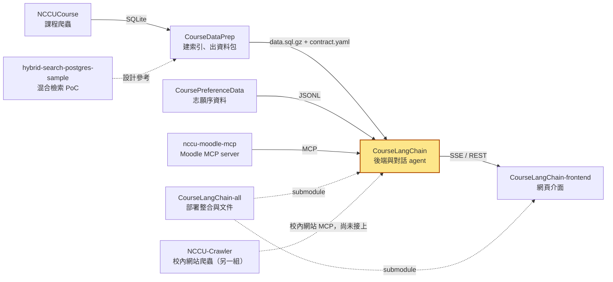

# CourseLangChain 文件

> 最後確認：2026-11-15，對照 `feat/course-card-api`（PR #7）加上 `fix/stream-hide-tool-output`。
> 文件與程式不一致時，以程式為準，並請更新本文件。

政大選課助理的**後端**：接收學生的中文問題，由對話 agent 決定要查課、看課綱、排課表、查志願序或查 Moodle，
再把結果寫成回答，以 SSE 串流給前端。

---

## 摘要

學生不必記得課號或查詢語法，直接問「我想修資訊相關的課，幫我排 15 學分，避開星期五」。
後端的設計原則是**分工**：語言模型只負責理解問題、選擇要用的功能、把結果寫成回答；
衝堂、學分加總、課號這些必須正確的事，一律由程式處理，課號甚至不經過模型轉述。

| 項目 | 現況（2026-11-15） |
|---|---|
| 課程資料 | 115-1 學期，2,926 門課 |
| 課程檢索 | BM25 與向量混合檢索，離線評估 nDCG@10 0.853（單用 BM25 0.761、單用向量 0.721），見[課程檢索](RETRIEVAL.md) |
| 功能 | 查課、看課綱、排課表、管理課表、查志願序、讀成績單、查 Moodle 作業與成績 |
| 完整排課一題 | 約 22 秒（含 3 ~ 5 次模型呼叫，Gemini 免費額度） |
| 安全 | 輸入清理、步數與錯誤防護、輸出驗證三層（`harness/`） |

**限制**：語言模型用 Gemini 的免費額度，每個型號每天約 20 次呼叫，一天只夠示範幾題；
評估只涵蓋字面型的查詢；其他已知問題見下方。

## 在系統中的位置



---

## 功能與對應程式

| 功能 | 工具（模型可呼叫） | 程式 |
|---|---|---|
| 查課（列出多門候選） | `retrieve_tool` | [`tools/retrieve.py`](../tools/retrieve.py)，詳見 [RETRIEVAL.md](RETRIEVAL.md) |
| 時段、語言、學分條件 | `text_to_sql_tool` | [`tools/text_to_sql.py`](../tools/text_to_sql.py)、[`tools/constraints.py`](../tools/constraints.py) |
| 看單一門課的課綱 | `course_detail_tool` | [`tools/course_detail.py`](../tools/course_detail.py) |
| 排課表（不衝堂、學分達標） | `schedule_tool` | [`tools/schedule_tool.py`](../tools/schedule_tool.py)、[`tools/scheduler.py`](../tools/scheduler.py) |
| 讀寫右側課表面板 | `my_schedule_tool` | [`tools/my_schedule.py`](../tools/my_schedule.py)、[`tools/session_schedule.py`](../tools/session_schedule.py) |
| 志願序要排第幾 | `preference_order_tool` | [`tools/preference_order.py`](../tools/preference_order.py)，資料在 [`data/`](../data/) |
| 讀成績單（去識別化） | `user_profile_tool` | [`tools/user_profile.py`](../tools/user_profile.py)、[`tools/transcript_parser.py`](../tools/transcript_parser.py) |
| Moodle 作業、成績、公告 | 由 MCP server 提供 | [`tools/mcp_tools.py`](../tools/mcp_tools.py)、[`tools/session_moodle.py`](../tools/session_moodle.py) |
| 課程卡片（前端點開的詳細資料） | 不經模型，REST API | [`tools/course_info.py`](../tools/course_info.py) |

對話 agent 是 LangGraph 的 `create_react_agent`，系統提示與工具接線在 [`agents/brain_agent.py`](../agents/brain_agent.py)；
串流與側通道（進度提示、候選課程、排課方案）在 [`main.py`](../main.py) 的 `astream`。

---

## 開發者指南

### 啟動

- 本機從零啟動：[START.md](START.md)
- 安裝、放資料、換資料版本（`ops.deploy`）：[SETUP.md](SETUP.md)

容器啟動後約需 30 ~ 50 秒才能服務，`docker ps` 顯示 Up 不代表就緒。確認方式：

```sh
until curl -sf http://localhost:8000/api/terms >/dev/null; do sleep 2; done; echo 後端就緒
```

### 設定

`.env` 不會進容器，容器內的設定由 `docker-compose.yml` 的 `environment:` 決定（`DOCKER_*` 變數）。
模型只讀三個變數：`OPENAI_BASE_URL`、`OPENAI_API_KEY`、`OPENAI_MODEL`（[`utils/llm.py`](../utils/llm.py)）。
改了 `.env` 要 `docker compose --profile app up -d --force-recreate app`；改了程式要加 `--build`。

### 目錄

```
agents/        對話 agent 與系統提示
tools/         模型可呼叫的工具，以及課表、Moodle、成績單的 session 狀態
harness/       三層防護：L1 輸入清理、L2 步數與錯誤防護、L3 輸出驗證
utils/         LLM 建立、時間代碼解析、分詞
evaluation/    離線檢索評估
ops/           線上換資料包（ops.deploy）
mcp_servers/   MCP 的假 server，給測試與本機開發用
data/          志願序資料（從 CoursePreferenceData 複製）
db/init/       資料庫第一次啟動時還原的資料包
tests/         測試（獨立腳本，不依賴 pytest）
app.py         FastAPI 入口
main.py        CourseLangGraph：串流、側通道、三層防護的接線
paths.py       所有設定的唯一讀取點
contract.yaml  資料契約（從 CourseDataPrep 原樣複製，不要在這裡改）
```

### API

| 方法與路徑 | 用途 |
|---|---|
| `GET /api/ask?question=…&session_id=…` | 對話，SSE 串流 |
| `GET /api/terms` | 可選學期（也當作健康檢查） |
| `GET /api/courses/{course_id}` | 課程卡片 |
| `GET` / `POST` / `DELETE /api/schedule` | 課表面板的查看、加課、移除 |
| `POST /api/schedule/apply` | 一鍵套用排課方案 |
| `GET` / `POST` / `DELETE /api/profile` | 成績單（只存在記憶體） |
| `GET` / `POST` / `DELETE /api/moodle` | Moodle 登入狀態 |

SSE 的 `data` 有兩種：`{"data": "文字"}` 是回答（最後一則是 `SPECIAL_END_TOKEN`）；
`{"type": "status" | "courses" | "plans", …}` 是側通道。每 15 秒送一行 `: keepalive`，避免 nginx 判定連線閒置。

### 測試

每支測試都是獨立腳本：

```sh
uv run python -m tests.test_stream_filter      # 串流只送最終答案（假模型，不需要資料庫）
uv run python -m tests.test_eval_metrics       # 評估指標
uv run python -m tests.test_schedule_plans     # 排課方案
uv run python -m tests.test_harness_integration
uv run python -m tests.test_mcp_tools
uv run python -m tests.test_moodle_mcp
```

`test_memory` 在 `main` 上有 1 項既有失敗（步數統計），`test_user_profile` 有 2 項，與近期修改無關。
「一鍵跑完全部測試」與 CI 在 `feat/harness-hardening` 分支，尚未合併。

### 已知問題

- 檢索相關的問題（SQL 條件直接插入字串、資料庫用超級使用者、無相關度門檻、含字母課號拿不到卡片等）見
  [RETRIEVAL.md 的已知問題](RETRIEVAL.md#已知問題與改進方向)。
- **Moodle MCP 的寫入工具。** `nccu-moodle-mcp` 的 `main` 在 2026-11 新增了 `submit_assignment`（替學生送出作業）。
  後端載入 MCP 工具時沒有白名單，server 更新後 agent 會拿到這個工具。建議在 `tools/mcp_tools.py` 只放行唯讀工具。
- 排課方案的「上課日」以 Unicode 排序，會顯示成「一三二四」（`tools/scheduler.py` 的
  `format_schedules_markdown` 與 `plans_to_dicts`，兩處要一起改）。
- 資料契約：後端的 `contract.yaml` 是第 8 版，CourseDataPrep 已是第 9 版（多了 v4）。換新資料包時要一起更新。

## 文件索引

| 文件 | 內容 |
|---|---|
| [RETRIEVAL.md](RETRIEVAL.md) | **課程檢索**：混合檢索、條件過濾、評估、已知問題 |
| [START.md](START.md) | 本機啟動 |
| [SETUP.md](SETUP.md) | 安裝、放資料、換資料版本 |
| [ARCHITECTURE_BLUEPRINT.md](ARCHITECTURE_BLUEPRINT.md) | 早期架構藍圖（檢索段落已過時，以 RETRIEVAL.md 為準） |
| [evaluation/README.md](../evaluation/README.md) | 離線檢索評估 |
| [mcp_servers/README.md](../mcp_servers/README.md) | MCP 假 server |
| [weekly-notes/](weekly-notes/) | 週記 |
| [部署整合文件](https://github.com/NCCU-AI-SYSTEM/CourseLangChain-all/blob/main/docs/README.md) | 整個服務的使用者手冊與開發者文件 |
